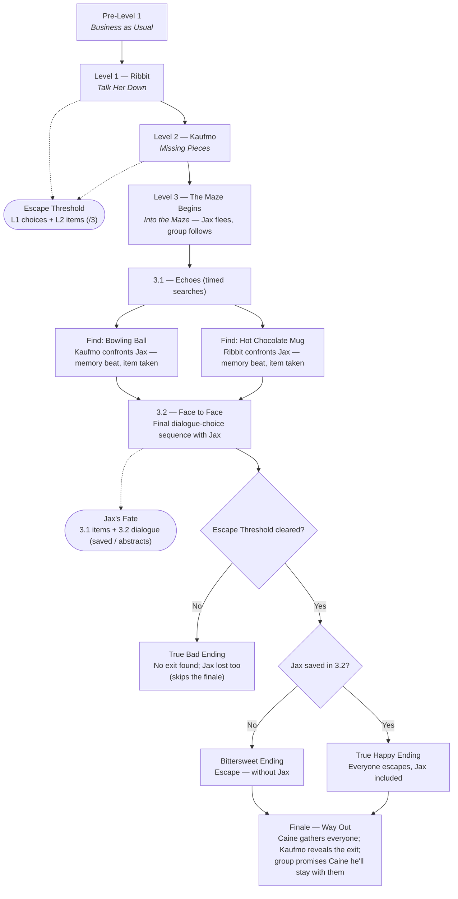

# The Digital Circus: Cracks in the Act

**Team Storyline Reference**
*Full level-by-level narrative outline · playable protagonist: Pomni*

---

## Pre-Level 1 — Orientation

**Suggested name:** *"Business as Usual"*

> **Purpose:** Introduce the world through Pomni's already-familiar POV, without her breaking character to explain things — the player learns by watching her react, not by being told.

- Player controls Pomni in the main tent going through an ordinary circus morning. Presented in 3D exploration; dialogue triggers drop into a Persona-style overlay (2D portraits in the corners, text box below).
- Casual banter with Ragatha establishes the cast (Caine, Kinger, Gangle, Zooble, Jax, Ribbit) and Pomni's dry, weary tone.
- Jax passes by, visibly on edge — a wordless tell that something is wrong before anyone says so directly.
- Ragatha's tone drops: something happened between Jax and Ribbit, and it's changed him.
- Pomni goes to find Caine, who confirms it: Jax and Ribbit had a serious fight, Jax has been harsher and more volatile since, and Ribbit has gone quiet — a warning sign for **abstraction**.
- Caine's tone breaks from showman-bit to genuine worry as he explains abstraction: the fail state where a character who spirals too far stops being themselves.
- Caine asks Pomni to check on Ribbit, then says **he'll go check on the rest of the circus himself**, to make sure everyone else is okay.

> **Design note:** this scene plants the abstraction threat purely through dialogue, so it lands as lore before it ever becomes a UI mechanic.

---

## Level 1 — Ribbit

**Suggested name:** *"Talk Her Down"*

> **Goal:** Help Ribbit calm down before the tension from her fight with Jax pushes her toward abstraction.

- Pomni finds Ribbit withdrawn and shaken. This is the game's first **dialogue-choice sequence** — the player picks responses that either ease or escalate Ribbit's distress.
- As Ribbit opens up, she reveals a second thread: Jax has also been lashing out at **Kaufmo**, mocking him as "crazy" for believing he can find a way out of the circus.
- Level ends with Ribbit stabilized, and the player's attention redirected toward Kaufmo for Level 2.

> **Scoring:** every dialogue choice here is graded. Good choices add points to the **Escape Threshold**; every bad/wrong choice earns **zero** points.

---

## Level 2 — Kaufmo

**Suggested name:** *"Missing Pieces"*

> **Goal:** Find proof to reassure Kaufmo and pull him out of his spiral.

- Pomni finds Kaufmo pacing in circles in his room, spiralling as he tries to prove the circus has an exit.
- Exploration task: find **3 objects** scattered around the circus (framed as pictures of the real-world C&A office) that support his theory.
- Kaufmo takes the objects/pictures from Pomni, thanks her, and says these were the missing pieces he needed.
- He tells Pomni he'll come find her once he's worked out the answer — setting up his return in the finale.

> **Scoring:** each item actually found and presented to Kaufmo = 1 point toward the **Escape Threshold** (out of 3 possible). Presenting only 1 of 3 items means only 1/3 points — a low score.

---

## Level 3 — Final Level — Jax

**Suggested name:** *"Into the Maze"*

- Pomni, Ribbit, and Kaufmo try to approach Jax together. He bolts into a maze.
- Pomni chases him, calling out *"Jax, wait!"* — Kaufmo and Ribbit, who happen to be passing, witness this and follow her in.

### 3.1 — Echoes

- **Timed search 1:** find a **bowling ball** (tied to memories with Kaufmo). On success, Jax spawns nearby (still behind a few walls). Kaufmo runs to him with the ball, reminding him of good times and the exit evidence — and that he misses him. Jax takes the ball and flees again.
- **Timed search 2:** find a **hot chocolate mug** (tied to memories with Ribbit). On success, Jax spawns nearby again. Ribbit approaches, reminding him of their café wind-downs. Jax takes the mug and flees again.
- If a search timer runs out without the item found, Jax still spawns nearby regardless — the chase always continues, but without the emotional beat (and without the points below).

### 3.2 — Face to Face

- Kaufmo and Ribbit stay back; Pomni asks to approach Jax alone.
- She finds him glitching. Final dialogue-choice sequence begins — the emotional climax of the game.

> **Jax's Fate meter:** a second hidden meter, separate from the Escape Threshold, built entirely within Level 3 — points from the 3.2 dialogue choices, plus bonus points for each item (bowling ball, mug) recovered in 3.1. Its final value determines whether Jax is saved or abstracts.

---

## How the Two Meters Decide the Ending

| Gate | Built from | Effect |
|---|---|---|
| **Gate 1 — Escape Threshold** | Level 1 (Ribbit dialogue) + Level 2 (items presented to Kaufmo) | Falls short → the party never finds a way out, no matter what happens with Jax. |
| **Gate 2 — Jax's Fate** | Level 3 (3.1 items + 3.2 dialogue) | Only comes into play once the Escape Threshold is cleared — decides whether Jax is saved or abstracts. |

### Endings

| Ending | Condition | Outcome |
|---|---|---|
| **True Happy Ending** | Escape Threshold cleared, and Jax is saved in 3.2. | The group escapes the circus together, Jax included. |
| **Bittersweet Ending** | Escape Threshold cleared, but Jax abstracts in 3.2. | The group escapes — without him. |
| **True Bad Ending** | Escape Threshold not cleared (weak L1/L2 performance). | The party never finds the exit; if Jax also abstracts, this is the game's worst outcome. |

> **Not yet pinned down:** what happens if the Escape Threshold is missed but Jax is still saved in 3.2. Currently folded into the True Bad Ending (no escape = failure state regardless of Jax) — worth confirming with the team, or splitting into its own 4th ending if you want that nuance.

---

## Ending — Way Out

*(True Happy / Bittersweet variant — the party has cleared the Escape Threshold)*

- Pomni returns from the maze. Caine approaches her.
- Pomni tells him there's an exit, and asks him to gather everyone else in the circus.
- Caine snaps the whole group together on the spot; Kaufmo explains how to reach the exit.
- Caine grows anxious — unsure whether he's even able to leave.
- The group reassures him: once they're out, they'll keep him with them by keeping him on their phones.
- If Jax is with them: he's part of this scene too. If he abstracted in 3.2, the group leaves without him — the bittersweet variant.

---

## Sequence Diagram

---

*Names marked as "Suggested name" are suggestions — swap freely before this goes in the pitch deck.*
