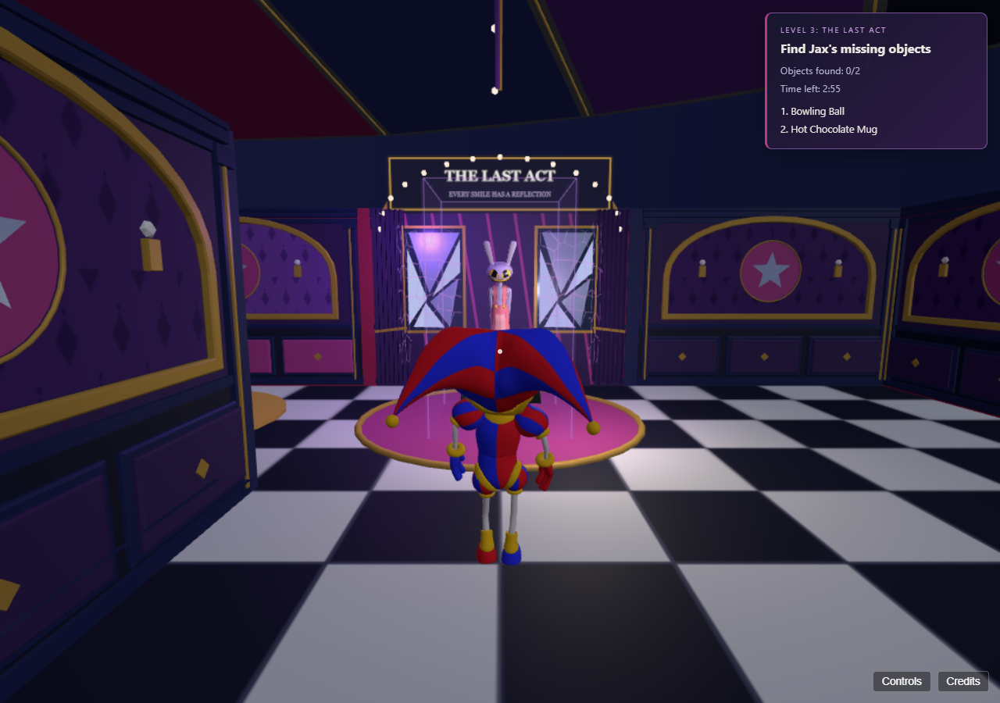
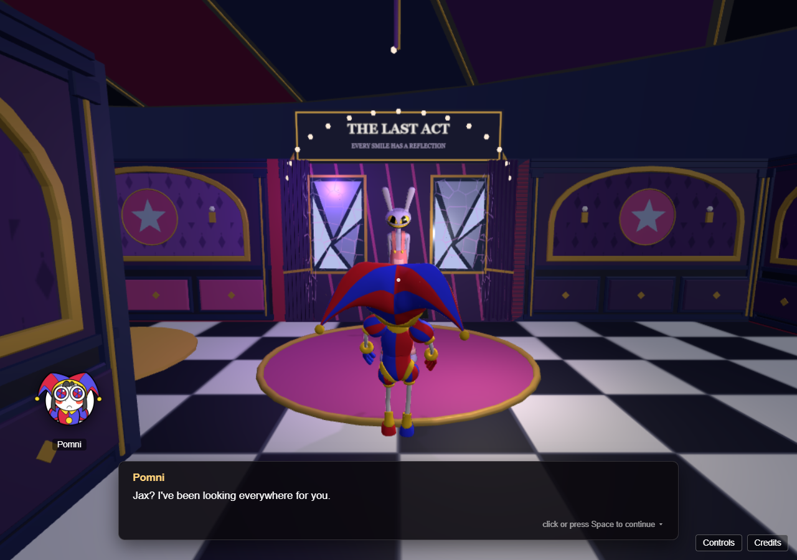
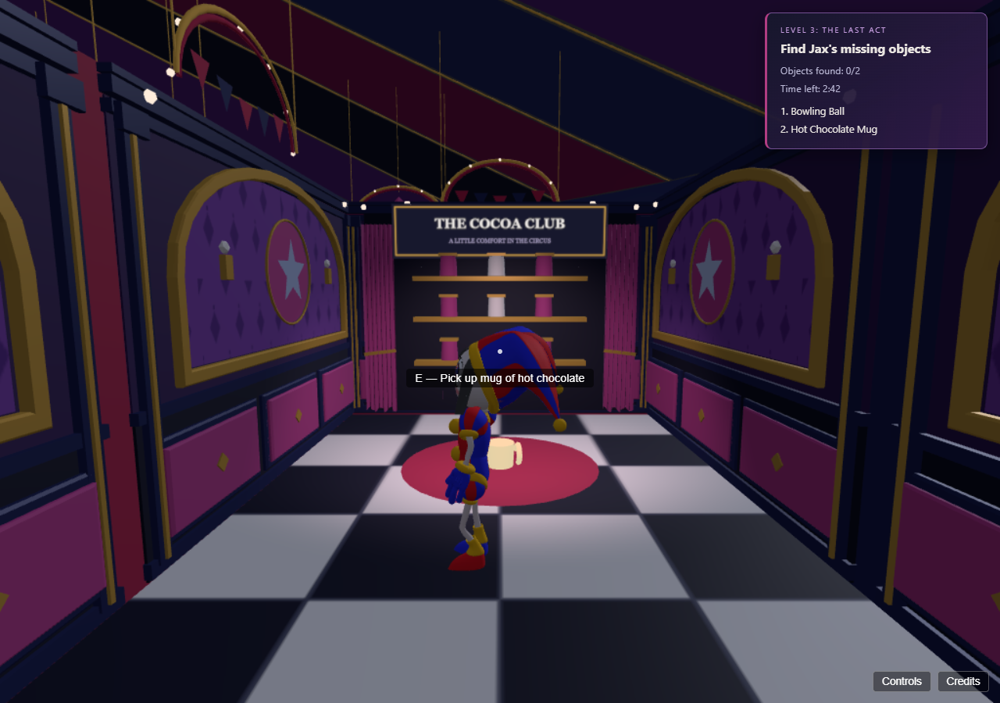

# The Last Act: Jax encounter implementation

## Player flow

Explore and collect the bowling ball and hot chocolate mug in either order. The tracker moves from **Find Jax's missing objects** (0/2, 1/2) to **Find Jax** (2/2). The small digital enclosure disappears and its collisions are removed in the same synchronous update. Approach Jax within 2.35 m with clear line of sight to start the conversation automatically: **Face to Face**, five graded choices that decide Jax's Fate (see below). Finishing it, whichever way it goes, gives **Reach the exit**. Only then can the existing exit complete the maze.

## Manual test on port 5174

1. Open `http://127.0.0.1:5174/?dev=1&mazeSeed=123`, choose **Maze (raw, no intro)**, then click to play. Refreshing this URL starts fresh unsaved progress; saved slots remain available.
2. Check the 0/2 tracker. The bowling ball is in **LOST & FOUND**, grid row 3 / column 10. The mug is in **THE COCOA CLUB**, row 0 / column 6. Coordinates are zero-based. Seeded placements are unchanged. Walk within 2.2 m and press E when prompted; precise floor aiming is no longer required.
3. If you visit Jax first, his enclosure blocks physical contact while the chamber and exit route remain traversable. He remains visible and distressed. The exit shows an objective hint instead of ending the level.
4. Pick up either object with E: the checklist immediately shows 1/2. Pick up the other: the tracker shows 2/2 and **Find Jax**.
5. Reach **THE LAST ACT**, row 12 / column 3. Walk toward the now-open stage. Within 2.35 m and with an unobstructed view, the standard dialogue overlay starts without E.
6. Advance through the six lines with Space or the normal dialogue controls. The final line must be advanced/finished; merely opening it does not complete the encounter.
7. The HUD changes to **Reach the exit**. Reach the existing exit marker at row 12 / column 4 to use the original Maze Complete overlay.
8. Esc uses the existing pause/resume behaviour, including during conversation. Save/Load use the existing menu slots. Level 3's raw review entry can now save checkpoints too; Level 1/2 preview rules are unchanged. Loading returns to the room's normal spawn with the saved seed and progression.

Also test `http://127.0.0.1:5174/?dev=1&mazeSeed=187` for the four-way-Jax-cell case. The floor stage is now correctly centred under Jax even when its theatrical backdrop must attach to another chamber wall.

Review gallery: `http://127.0.0.1:5174/artifacts/jax-encounter/review.html`.

## Pose and staging

The original GLB and its 60-joint skeleton are preserved. `setDistressed(true)` is opt-in and called only by the maze. Rest-relative rotations give a modest spine/chest slump, a lowered neck/head, slightly drawn-in arms, slow breathing and intermittent tiny twitches. No bone rotations accumulate. During dialogue the head eases upward slightly and the body turns slowly toward Pomni while retaining distress. Waiting Jax does not automatically track the player.

The actual GLB's head root drops approximately 2.5 cm compared with the previous idle, with additional head/neck pitch. The original facial expression is unchanged: there are no morph targets. No body flashing, material replacement, new voice assets or character shader is introduced. The existing chamber cracks supply environmental instability.

The real-model regression compares every bone quaternion and root pose against the committed previous Jax idle/run implementation. Modified bones are restored before running/pass-by animations.

## Boundary and movement safety

The personal enclosure is approximately 1.70 m wide and 2.9 m high, centred on Jax inside the existing 3.6 m diameter pink stage. Four lightly tinted panels have exact matching Box3 colliders. A room-owned outline has explicit cleanup through the normal mesh teardown hook. No extra lights, textures or custom shaders are added.

A 40-seed prototype, including 123 and 187, proves conservative 0.35 m player-radius navigation to every other cell while Jax's centre is enclosed. Real-model checks repeat the proof on eight fixed seeds with the actual room boxes, then verify access to Jax after unlocking. Existing wall/collider checks exclude only the separately identified new boundary boxes.

The developer sprint multiplier can move across a thin panel in one frame. A swept XZ check owned exclusively by this boundary prevents tunnelling and permits sliding. It does not alter maze generation, the original wall solver, enemy paths or other rooms. A player somehow placed inside the locked enclosure is moved to its nearest safe face instead of trapped. Actual movement verification, including repeated sprint/jump input, stops at approximately 1.1975 m from Jax's centre.

## Dialogue lifecycle and exit

`level3JaxFinalDialogue` is the Face to Face script (below), separate from the Dorm Hall's `level3JaxDialogue`. The existing overlay, portraits, naming, input, pause behaviour and player camera are reused. No new cinematic camera is introduced.

The approach controller checks both explicit required IDs, short range, same-floor proximity, line of sight and eligible gameplay. It cannot start during pause, another dialogue, cinematic or loading. It latches while active. Completion is recorded only by the normal `onComplete` event. Cancellation does not unlock the exit; leaving range and re-approaching resumes from the last seen line within that room. Reloading an incomplete checkpoint starts the short provisional conversation again. Completed encounters do not replay after re-entry or save restore. Generation/disposal guards reject stale callbacks.

The broad legacy Jax Box3 remains for layout diagnostics, but no longer awards encounter progress. Early exit visits show a rate-limited objective hint. Successful exit triggering is guarded by the existing `reachedExit` latch.

## Checkpoints and HUD

`createMazeItems()` now validates the two known IDs, suppresses duplicates, owns the run's retained maze seed and completed-Jax flag, and provides additive snapshot/restore. Unknown IDs and invalid seeds are discarded. Completion cannot restore without both required objects. Loading missing/older maze data resets the state rather than inheriting another run. Save version 1 remains compatible because the new checkpoint field is optional.

Each pickup and completed encounter updates the existing checkpoint. New Game clears objects, seed and completion. Room re-entry retains them and consumes the same seeded placement slots, so collected objects stay absent and remaining ones stay in place. No Escape Threshold scoring changes.

The compact purple/blue tracker reuses the existing objective visibility policy, hides during dialogue/pause/loading and outside the maze, and adapts to narrow browser widths. Existing Level 1 and Level 2 objectives and their HUD are unchanged.

## Files changed

Production:
- `src/characters/jax.js`: opt-in distress and full pose restoration.
- `src/state/mazeItems.js`: explicit requirements, retained seed, completion and snapshot/restore.
- `src/levels/mazeEncounter.js`: automatic encounter lifecycle, cancellation/resume and stale-callback guards.
- `src/rooms/jaxStageBoundary.js`: matching boundary geometry/collisions and local motion sweep.
- `src/rooms/mazeRoom.js`: boundary/pose attachment and exposed encounter anchors.
- `src/rooms/mazeEnvironment.js`: retain the floor stage under Jax in the four-way-cell fallback.
- `src/main.js`: checkpoint, approach/LOS, exit and HUD integration.
- `src/ui/mazeObjectiveHUD.js` and `index.html`: compact state-driven tracker.
- `src/data/dialogues.js`: provisional final script only.

Verification:
- `_verify_maze_encounter.mjs` and `package.json`.
- `tools/mazeBoundaryNavigation.mjs` and `tools/verify_maze_findables.mjs`.
- `tools/verify_jax_distress_bones.mjs`.
- `tools/verify_jax_encounter_browser.mjs`.
- `tools/verify_maze_shaders_browser.mjs`: configurable software-test resolution/navigation timeout only.

The generator/layout modules, collectible meshes, both GLSL files, shader update code, maze lighting and overhead architecture are unchanged. The development notes above describe the pre-PR implementation and verification stages. Changes are confined to the isolated feature worktree; the original workspace and existing stashes are preserved.

## Final verification results

- `npm test`: 74 tests pass, plus the dialogue and collision self-checks.
- `node tools/verify_maze_findables.mjs`: 32 real-model layout checks and eight fixed seeds including 123/187 pass; locked navigation, unlocked access, original wall equality and stage centring are verified.
- `node tools/verify_jax_distress_bones.mjs`: default idle and running poses match the committed previous implementation bone-for-bone; head lowering and zero-delta stability pass.
- `node tools/verify_jax_encounter_browser.mjs`: actual pickup/approach/dialogue flow, both collection orders, line-of-sight obstruction, cancellation/re-approach, pause, real save slots at 0/2, 1/2, 2/2 and completed, an older save without maze data, New Game reset, early-exit refusal and completion exactly once all pass. Seeds 123 and 187, desktop and 480x800 HUD captures pass with no browser/WebGL errors.
- `MAZE_WEBGL_TEST_PIXEL_RATIO=0.5 node tools/verify_maze_shaders_browser.mjs`: shader compilation/rendering for seeds 0, 42 and 123; visible animation for both effects; pause/resume and proximity; three room re-entries all pass. GPU memory remains at 90 geometries / 19 textures. The test harness handles Vite cache-busting module URLs.
- `npm run package`: production build and deployment package pass (217 referenced files). Existing large-bundle advisory remains.

Performance: the locked boundary adds four panel draws plus one outline, 48 triangles and 12 line segments, with no new lights or textures. It renders nothing once unlocked. Software-rendered overview timing at pixel ratio 0.5 was about 1167 ms without the existing shader pair and 1170 ms with it (12 interleaved samples); these loaded-machine/software numbers are not a lab-hardware FPS guarantee. Shader overhead remains two calls / 3,084 triangles. Lab-machine performance and subjective visual/narrative quality still require review.

The GLB's fixed smile remains; no facial morph targets or revised voice clips were introduced. The six-line conversation is provisional by request. No blocking functional failures remain in the completed checks.

## Pickup usability refinement

The mug retains its Cocoa Club floor position but is scaled 2.5 times larger. Both keepsakes now reuse the existing anchored interaction fallback with a 2.2 m proximity radius and same-floor/line-of-sight checks. Approaching and pressing E works without aiming the crosshair at a tiny floor mesh. Collected items disable their interaction immediately, and stale repeated calls are ignored. No shelf decorations, seeded placement, collision or progression rules change.

Verified in the actual playable browser by approaching both alcoves while looking normally toward their scenery and using real E keypresses: both objects collect, the HUD updates and the Jax boundary unlocks. The prompt stays hidden outside pickup range. Real-model multi-seed checks and the production build pass. Screenshots are `artifacts/jax-encounter/mug-larger-pickup-prompt.png` and `mug-collected-with-E.png`.

## Latest main integration (9f8f05f)

The feature worktree was fast-forwarded to the fetched main without creating a merge commit. Uncommitted files were backed up under `artifacts/pre-main-update-20261029/` before reconciliation; the original workspace and all three existing stashes were retained.

Incoming changes include the 180-second maze countdown, keepsake counter, Jax's original bind-pose API for the bedroom animation, Caine memory, credits and voice updates. The countdown/counter are integrated into the Last Act HUD. The countdown still stops on a valid close arrival with both keepsakes; the automatic final dialogue and completion-only exit gate supersede the upstream pending-dialogue placeholder. Expired attempts cannot start the encounter.

Validation after reconciliation: 94 automated tests pass, production build passes, real-model seeded navigation/pickup checks pass, and actual-browser verification confirms real E pickups, one integrated tracker, countdown stopping at Jax, automatic dialogue and exit gating until proper completion. No new commits were created and nothing was pushed during this update.

## Pull request review

Current gameplay screenshots:

The current standing distress pose and provisional conversation are included. A seated-pose redesign and a return-to-circus finale transition remain proposed future work. Completing this encounter does not implement the game's final escape or Jax's branching fate. The incoming countdown retains its existing per-attempt reset-on-load behaviour; its remaining time is not serialized in the new maze-progress checkpoint.

The maintained real-keyboard pickup regression is `node tools/verify_maze_pickup_browser.mjs` (Vite on port 5174).

## PR validation summary

The integrated tree passes 94 automated tests, all 25 standalone countdown/counter browser checks (including pause, timeout/retry, loading cancellation and room detours), the real-keyboard proximity pickup checker, real-model pose and seeded collision/navigation checks, and production packaging. The latest package includes 254 referenced files. Current gameplay screenshots above include the incoming countdown and numbered tracker. Existing large-bundle advisory remains.

## Face to Face: Jax's Fate and the Jax-less endings

`level3JaxFinalDialogue` now has five graded choices with three options each. The best answer is worth 1 point and the other two are worth 0, with a colder reply. Every branch rejoins the main line. **Jax's Fate** (`src/state/jaxFate.js`) is the second hidden meter from the storyline outline, kept separate from the Escape Threshold. It totals the choice points plus 1 per keepsake recovered (`KEEPSAKE_BONUS`). At the script's `jaxFate` beat, main.js (`faceToFace`, through DialogueUI's `nextFor`) checks the total once against `JAX_SAVE_MARK` = 4, the team plan's proposed mark:

- **Enough:** `jaxSaved`. His static fades, and the exit plays the `saved` ending (`leaveMaze`/`playEnding` in main.js).
- **Too many bad choices:** `jaxBreaks`. He abstracts on the `jaxAbstracts` beat using the shared abstraction effect (`jaxApi.abstraction`, made in `mazeRoom.js`). The dialogue waits while it plays. HUD: **Reach the exit**, with the hint "Jax is gone. Find your way out of the maze."

Both keepsakes are currently required to reach Jax, so the bonus is always 2. In practice, two good answers out of five save him, and four or five bad ones lose him. Items alone never save him. Tune it with `JAX_SAVE_MARK` / `KEEPSAKE_BONUS`.

His visible distress starts at 2 (glitching) and moves a step per answer, down for good and up for poor, capped at 3. It drives both the box shake on his lines and the effect's static, so bad choices visibly push him toward the edge. Answers are set per choice, not added, so a cancelled and resumed conversation can't stack points. The outcome latches once decided.

`jaxOutcome()` in main.js reads the outcome for the ending (`storyProgress.ending`, see story-flow.md). On reaching the exit after he abstracted, `resolveEnding` (`src/game/endings.js`, a pure two-gate resolver) picks the ending:

- **Escape Threshold cleared → Bittersweet.** The `abstracted` ending from `src/cutscenes/endingCutscene.js`: the Lobby talk (`endingLobbyAbstractedDialogue`), then the exit door (`exitDoorAbstractedDialogue`), the group leaving without him, then the **Level 3 Complete** card.
- **Not cleared → No Way Out** card, Back to Title (`playNoEscapeEnding`).

`endingBittersweetDialogue` (the earlier, Lobby-only take on the bittersweet ending) is kept as a dialogue preview but isn't played in the story.

No checkpoints are taken while the No Way Out card is up, so a save still returns to the walk out of the maze. Checkpoints keep the outcome (`jaxFate` in the save, only once the encounter is complete), and reloading or re-entering the maze shows him still abstracted. The no-escape/saved combination still plays the `saved` ending.

The raw maze review entry has no Escape points, so losing Jax there shows No Way Out. To see the bittersweet ending in it, set points from the console first: `(await import('/src/state/escapeThreshold.js')).restoreEscapeThreshold({ level1: 4, level2: 5 })`.

The abstraction effect now takes the character's own meshes off every layer once progress reaches 1. Its void is stretched upward, and on Jax's tall, narrow body that left his real head showing beneath it. Kaufmo's scenes end on the card at that point, so nothing changes for him.

Verification: `node --test test/_verify_jax_fate.mjs` (all 243 choice paths, the save mark with 0/1/2 keepsakes, latching, distress, saves, every gate combination) and, with Vite on 5174, `node tools/verify_jax_fate_browser.mjs`. The browser check plays the conversation with real number-key/Space input three times: bad choices with Escape cleared (abstraction, save/load, Lobby scene, Bittersweet card, Back to Title), bad choices with Escape missed (No Way Out), and good choices (static clears, Maze Complete). Screenshots go to `artifacts/jax-fate/`. `tools/verify_jax_encounter_browser.mjs` now answers the choices instead of pressing Space six times.
