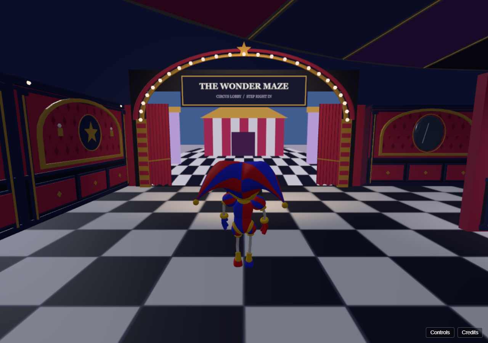
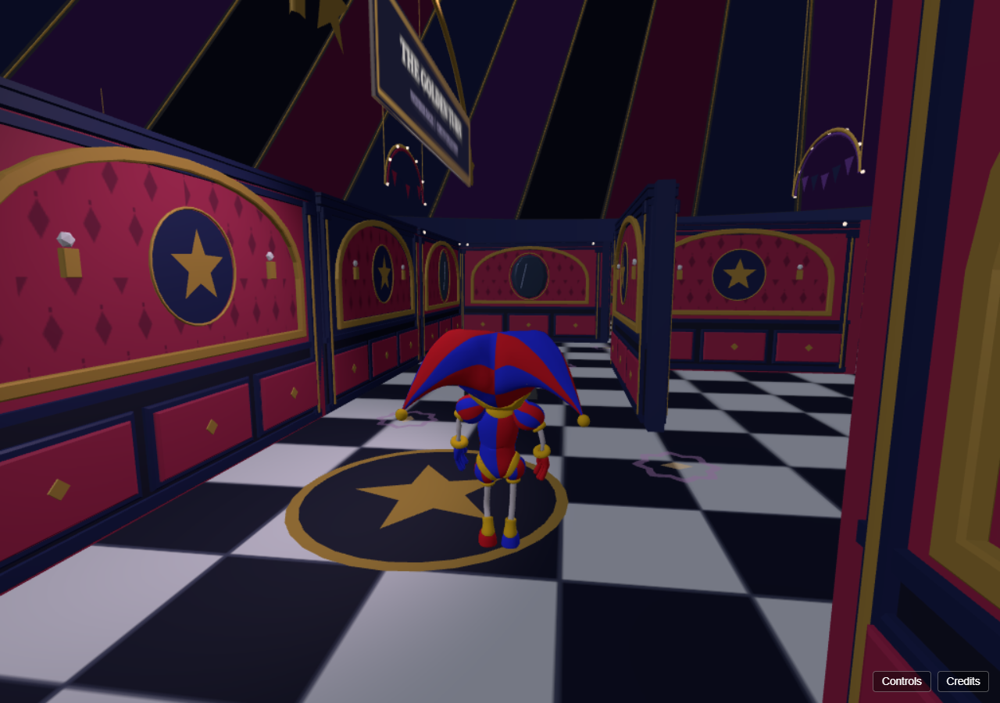
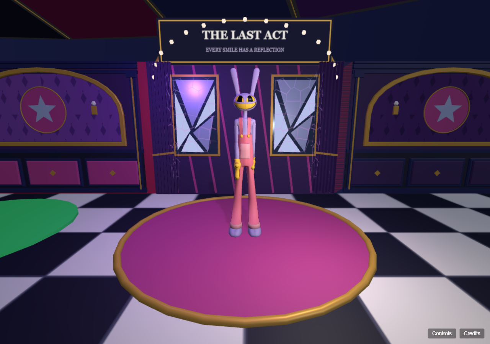

# Level 3 funhouse redesign: PR review

Level 3 now uses a deliberate seeded layout, layered circus architecture and a moody crimson/navy/violet palette. It preserves the 13x13 footprint and spawn, the existing hazard route and mechanics, both collectible interactions, dialogue, scoring and room transitions. Jax is placed in a distant chamber by the layout pass before walls and colliders are built.

## Review locally

Run `npm install`, then `npm run dev -- --port 5174`. Open `http://localhost:5174/?dev=1&mazeSeed=123` and choose **Maze (raw, no intro)**. The standalone `maze-review.html?mazeSeed=123` inspection tour provides direct viewpoints without changing the playable camera.

These are actual seed-123 gameplay captures:

### Entrance

### Decorated corridor

### Jax chamber at the normal 1.7 m first-person camera

## Validation

- `npm test`: 66 tests pass, plus dialogue/collision scripts.
- `node tools/verify_maze_findables.mjs`: real-model checks across 32 seeds; eight fixed seeds for scenery clearance, pickups, wall/collider agreement, trigger anchors, floor motif alignment, lighting budgets and disposal.
- Edge WebGL checks: shaders compile/render on seeds 0, 42 and 123; visible animation, proximity, pause/resume and stable GPU counts across three re-entries.
- Final palette gameplay captures: eight matched before/after poses, two extra collectible eye-height views, no WebGL errors. Overall image brightness is lower than the preceding visual version.
- `npm run package`: production build and deploy package pass (217 referenced files). Vite retains its large-bundle advisory.

Both shaders use custom Three.js ShaderMaterial with GLSL. Active patrol warnings animate amber/violet chevrons; future loops have static circus rosettes. No Gloink AI, new objectives, timers, dialogue, dependencies or global renderer changes are included. Architecture uses shared/instanced geometry, spatial culling and two 512px shadow maps. Lab-hardware performance still needs confirmation.

The other maze design documents record the earlier review stages; their no-commit/no-push notes describe the state before this PR was requested. Generated before/after galleries, videos and diagnostic reports remain in ignored `artifacts/`; the capture tools are included so reviewers can reproduce them.
